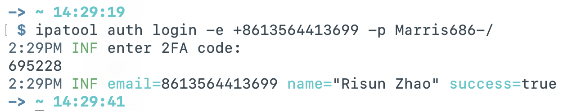

<style>
    pre {
        word-wrap: break-word;
        white-space: pre-wrap !important;
        overflow-wrap: break-word;
    }
    code, tt {
        white-space: pre-wrap !important;
        word-break: break-all;
        overflow-wrap: break-word;
    }
</style>

[TOC]

## ipa 下载参考文档

https://github.com/majd/ipatool  
https://github.com/EEliberto/Pastel-macOS  
https://juejin.cn/post/7602894102993338378  
https://github.com/beer-psi/ipatool.ts  
https://zhuanlan.zhihu.com/p/2050135468772168505

## 安装 ipa 下载工具

`brew install ipatool`

## 登录

`ipatool auth login -e +8613564413699 -p Marris686-/`  
`ipatool auth login --help`

```
# 登录 Apple ID（开启双重验证需输入验证码）
ipatool auth login -e 你的邮箱 -p 你的密码
# 查看登录信息
ipatool auth info
# 登出/撤销凭证
ipatool auth revoke
```

注意：双重验证环境下，密码需用「App 专用密码」（Apple ID 管理页生成），避免登录失败。



## 下载 ipa

`ipatool search 支付宝`  
`ipatool purchase -b com.alipay.iphoneclient`  
`ipatool download -i 333206289`

`ipatool search --limit 1 TestFlight`  
`ipatool download --bundle-identifier com.apple.TestFlight`


## 查看 plist 文件中的 schema

`plutil -p Info.plist | grep -A 5 "CFBundleURLSchemes"`

## 查看 entitlements 文件中的 ulink

`codesign -d --entitlements :- NewsLite.app`

`com.apple.developer.associated-domains`

`apple-app-site-association`